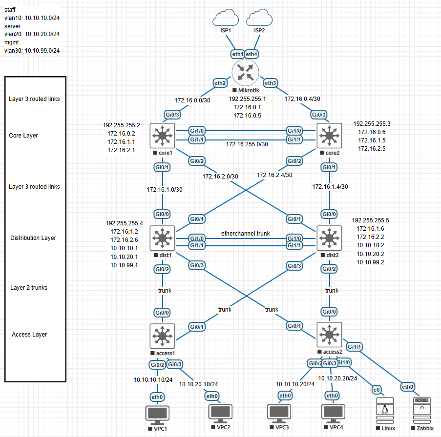

# Three-Tier Architecture


## The design



## Shortcut

[Core1](#core1) - [Core2](#core2) - [Dist1](#dist1) - [Dist2](#dist2) - [Access1](#access1) - [Access2](#access2) - [Verify](#verify)

## mikrotik router

### WAN

```routeros
/ip address
add address=172.16.0.1/30 interface=ether2
add address=172.16.0.5/30 interface=ether3
add address=public-ip/30 interface=ether1-wan
```

```routeros
/ip route
add dst-address=0.0.0.0/0 gateway=ISP-gateway
```

### NAT

```routeros
/ip firewall nat
add chain=srcnat out-interface=ether1-wan action=masquerade
```

### IP addresses

```routeros
/ip address
add address=172.16.0.1/30 interface=ether2-core1
add address=172.16.0.5/30 interface=ether3-core2
add address=192.255.255.1/30 interface=lo
```

### OSPF

```routeros
/routing ospf instance
add name=default router-id=192.255.255.1 originate-default=always

/routing ospf area
add name=backbone area-id=0.0.0.0 instance=main

/routing ospf interface-template
add interfaces=ether2 area=backbone
add interfaces=ether3 area=backbone
```

## 1. CORE layer

### core1

[Design](#the-design) - [Mikrotik](#mikrotik-router) - [Core2](#core2) - [Dist1](#dist1) - [Dist2](#dist2) - [Access1](#access1) - [Access2](#access2) - [Verify](#verify)

```ios
enable
configure terminal
hostname core1
ip routing
```

### core1 add loopback interface for stable ospf router id

```ios
interface loopback0
ip address 192.255.255.2 255.255.255.255
exit
```

### core1 interfaces routed ports

```ios
interface g0/3
no switchport
ip address 172.16.0.2 255.255.255.252
no shutdown
exit
```

### core1 to dist1

```ios
interface g0/1
no switchport
ip address 172.16.1.1 255.255.255.252
no shutdown
exit
```

### core1 to dist2

```ios
interface g0/2
no switchport
ip address 172.16.2.1 255.255.255.252
no shutdown
exit
```

### enable etherchannel layer 3 between core1 and core2

> Gi1/0/1-2

```ios
interface range g1/0-1
channel-group 1 mode active
no shutdown
exit

interface port-channel1
no switchport
ip address 172.16.255.1 255.255.255.252
no shutdown
exit
```

> check port status

```ios
show interfaces status
```

### if layer 2 trunk to core2

```ios
interface port-channel1
switchport trunk encapsulation dot1q
switchport mode trunk
end
```

### no switchport

```ios
ip address 172.16.1.1 255.255.255.252
end
```

### if single port core1 to core2

```ios
interface g0/0
no switchport
ip address 172.16.255.1 255.255.255.252
no shutdown
exit
```

### Core1 ospf

```ios
router ospf 1
router-id 192.255.255.2

passive-interface default

no passive-interface g0/1
no passive-interface g0/2
no passive-interface g0/3
no passive-interface g0/0
no passive-interface port-channel1

network 172.16.0.0 0.0.0.3 area 0
network 172.16.1.0 0.0.0.3 area 0
network 172.16.2.0 0.0.0.3 area 0
network 172.16.255.0 0.0.0.3 area 0
end
```

### show all ospf config

```ios
show running-config | section ospf
```

### core1 spanning tree

```ios
spanning-tree mode rapid-pvst
```

## core2

[Design](#the-design) - [Mikrotik](#mikrotik-router) - [Core1](#core1) - [Dist1](#dist1) - [Dist2](#dist2) - [Access1](#access1) - [Access2](#access2) - [Verify](#verify)

```ios
en
conf t
hostname core2
ip routing
```

### core2 add loopback interface for stable ospf router id

```ios
interface loopback0
ip address 192.255.255.3 255.255.255.255
exit
```

### interfaces routed ports

```ios
interface g0/3
no switchport
ip address 172.16.0.6 255.255.255.252
no shutdown
exit
```

### core2 to dist1

```ios
interface g0/1
no switchport
ip address 172.16.1.5 255.255.255.252
no shutdown
exit
```

### core2 to dist2

```ios
interface g0/2
no switchport
ip address 172.16.2.5 255.255.255.252
no shutdown
exit
```

### etherchannel to core1

```ios
interface range g1/0 - 1
channel-group 1 mode active
no shutdown
exit

interface port-channel1
no switchport
ip address 172.16.255.2 255.255.255.252
no shutdown
exit
```

### if layer 2 trunk to core1

```ios
interface port-channel1
switchport trunk encapsulation dot1q
switchport mode trunk
exit
```

### if single port to core1

```ios
interface g0/0
no switchport
ip address 172.16.255.2 255.255.255.252
no shutdown
exit
```

### Core2 ospf

```ios
router ospf 1
router-id 192.255.255.3

passive-interface default

no passive-interface g0/0
no passive-interface g0/1
no passive-interface g0/2
no passive-interface g0/3
no passive-interface port-channel1

network 172.16.0.4 0.0.0.3 area 0
network 172.16.1.4 0.0.0.3 area 0
network 172.16.2.4 0.0.0.3 area 0
network 172.16.255.0 0.0.0.3 area 0
exit
```

### core2 spanning tree

```ios
spanning-tree mode rapid-pvst
```

## 2. Distribution Switches

> switches are layer 3

## dist1

[Design](#the-design) - [Mikrotik](#mikrotik-router) - [Core1](#core1) - [Core2](#core2) - [Dist2](#dist2) - [Access1](#access1) - [Access2](#access2) - [Verify](#verify)

```ios
en
conf t
hostname dist1
ip routing
```

### dist1 add loopback interface for stable ospf router id

```ios
interface loopback0
ip address 192.255.255.4 255.255.255.255
exit
```

### dist1 vlans

```ios
vlan 10
name staff
exit
vlan 20
name server
exit
vlan 99
name mgmt
exit
```

### dist1 SVI gateway

```ios
interface vlan10
ip address 10.10.10.1 255.255.255.0
standby 10 ip 10.10.10.254
standby 10 priority 110
standby 10 preempt
no shutdown
exit

interface vlan20
ip address 10.10.20.1 255.255.255.0
standby 20 ip 10.10.20.254
standby 20 priority 110
standby 20 preempt
no shutdown
exit

interface vlan99
ip address 10.10.99.1 255.255.255.0
standby 99 ip 10.10.99.254
standby 99 priority 110
standby 99 preempt
no shutdown
exit
```

### dist1 etherchannel to dist2

```ios
interface range gi1/0 - 1
channel-group 1 mode active
no shutdown
exit

interface port-channel1
switchport trunk encapsulation dot1q
switchport mode trunk
exit
```

### dist1 dhcp relay

```ios
interface vlan10
ip helper-address 10.10.20.10
exit
interface vlan20
ip helper-address 10.10.20.10
exit
```

### dist1 interfaces routed ports layer 3 uplinks

```ios
interface g0/0
no switchport
ip address 172.16.1.2 255.255.255.252
no shutdown
exit

interface g0/1
no switchport
ip address 172.16.2.6 255.255.255.252
no shutdown
exit
```

### dist1 trunks ports

### dist1 to access1

```ios
interface g0/2
switchport trunk encapsulation dot1q
switchport mode trunk
switchport trunk allowed vlan 10,20,99
no shutdown
exit
```

### dist1 to access2

```ios
interface g0/3
switchport trunk encapsulation dot1q
switchport mode trunk
switchport trunk allowed vlan 10,20,99
no shutdown
exit
```

### Dist1 ospf

```ios
router ospf 1
router-id 192.255.255.4

passive-interface default

no passive-interface g0/0
no passive-interface g0/1

network 172.16.1.0 0.0.0.3 area 0
network 172.16.2.4 0.0.0.3 area 0

network 10.10.10.0 0.0.0.255 area 0
network 10.10.20.0 0.0.0.255 area 0
network 10.10.99.0 0.0.0.255 area 0
exit
```

### dist1 spanning root

```ios
spanning-tree mode rapid-pvst
spanning-tree vlan 10,20,99 priority 4096
```

## dist2

[Design](#the-design) - [Mikrotik](#mikrotik-router) - [Core1](#core1) - [Core2](#core2) - [Dist1](#dist1) - [Access1](#access1) - [Access2](#access2) - [Verify](#verify)

```ios
enable
configure terminal
hostname dist2
ip routing
```

### dist2 add loopback interface for stable ospf router id

```ios
interface loopback0
ip address 192.255.255.5 255.255.255.255
exit
```

### dist2 vlans

```ios
vlan 10
name staff
exit
vlan 20
name server
exit
vlan 99
name mgmt
exit
```

> HSRP for gateway redundancy
> clients use default gateway 10.10.10.254

### dist2 SVI gateway

```ios
interface vlan10
ip address 10.10.10.2 255.255.255.0
standby 10 ip 10.10.10.254
standby 10 priority 100
standby 10 preempt
no shutdown
exit

interface vlan20
ip address 10.10.20.2 255.255.255.0
standby 20 ip 10.10.20.254
standby 20 priority 100
standby 20 preempt
no shutdown
exit

interface vlan99
ip address 10.10.99.2 255.255.255.0
standby 99 ip 10.10.99.254
standby 99 priority 100
standby 99 preempt
no shutdown
exit
```

### dist2 etherchannel to dist1

```ios
interface range gi1/0 - 1
channel-group 1 mode active
no shutdown
exit

interface port-channel1
switchport trunk encapsulation dot1q
switchport mode trunk
exit
```

### show etherchannel info

```ios
show etherchannel summary
```

### dist2 dhcp relay

```ios
interface vlan10
ip helper-address 10.10.20.10
exit
interface vlan20
ip helper-address 10.10.20.10
exit
```

### new dhcp relay

```ios
interface vlan10
ip dhcp relay enable
ip dhcp relay address 10.10.20.10
exit
interface vlan20
ip dhcp relay enable
ip dhcp relay address 10.10.20.10
exit
```

**Verify:**

```ios
show ip dhcp relay
```

**and:**

```ios
show ip interface vlan 10
```

### interfaces routed ports dist2 L3 links

```ios
interface g0/0
no switchport
ip address 172.16.1.6 255.255.255.252
no shutdown
exit

interface g0/1
no switchport
ip address 172.16.2.2 255.255.255.252
no shutdown
exit
```

> dist2 trunks ports

### dist2 to access1

```ios
interface g0/3
switchport trunk encapsulation dot1q
switchport mode trunk
switchport trunk allowed vlan 10,20,99
no shutdown
exit
```

### dist2 to access2

```ios
interface g0/2
switchport trunk encapsulation dot1q
switchport mode trunk
switchport trunk allowed vlan 10,20,99
no shutdown
exit
```

### dist2 OSPF

```ios
router ospf 1
router-id 192.255.255.5

passive-interface default

no passive-interface g0/0
no passive-interface g0/1

network 172.16.1.4 0.0.0.3 area 0
network 172.16.2.0 0.0.0.3 area 0

network 10.10.10.0 0.0.0.255 area 0
network 10.10.20.0 0.0.0.255 area 0
network 10.10.99.0 0.0.0.255 area 0
exit
```

> That still advertises the networks into OSPF without sending hello packets to PCs

```ios
passive-interface vlan10
passive-interface vlan20
passive-interface vlan99
```

### dist2 spanning root secondary

```ios
spanning-tree mode rapid-pvst
spanning-tree vlan 10,20,99 priority 8192
```

## 3. Access Switch Configuration

## access1

[Design](#the-design) - [Mikrotik](#mikrotik-router) - [Core1](#core1) - [Core2](#core2) - [Dist1](#dist1) - [Dist2](#dist2) - [Access2](#access2) - [Verify](#verify)

>**Note:**
>
> - access switches remain layer 2 only
> - uplink port
> - GigabitEthernet1/0/48

### access1 config

```ios
en
conf t
hostname access1
```

### access1 vlan

```ios
vlan 10
name staff
exit
vlan 20
name server
exit
vlan 99
name mgmt
exit
```

### access1 uplink trunks

```ios
interface g0/0
switchport trunk encapsulation dot1q
switchport mode trunk
switchport trunk allowed vlan 10,20,99
no shutdown
exit

interface g0/1
switchport trunk encapsulation dot1q
switchport mode trunk
switchport trunk allowed vlan 10,20,99
no shutdown
exit
```

### access1 user ports

> GigabitEthernet1/0/1

```ios
interface g0/2
switchport mode access
switchport access vlan 10
spanning-tree portfast
spanning-tree bpduguard enable
exit

interface g0/3
switchport mode access
switchport access vlan 20
spanning-tree portfast
spanning-tree bpduguard enable
end
```

### access1 management IP

```ios
interface vlan99
ip address 10.10.99.31 255.255.255.0
no shutdown

ip default-gateway 10.10.99.254
exit
```

### access1 spanning tree

```ios
spanning-tree mode rapid-pvst
```

## access2

[Design](#the-design) - [Mikrotik](#mikrotik-router) - [Core1](#core1) - [Core2](#core2) - [Dist1](#dist1) - [Dist2](#dist2) - [Access1](#access1) - [Verify](#verify)

### access2 config

```ios
enable
configure terminal
hostname access2
```

### access2 vlans

```ios
vlan 10
name staff
exit
vlan 20
name server
exit
vlan 99
name mgmt
exit
```

### access2 Uplinks

```ios
interface g0/0
switchport trunk encapsulation dot1q
switchport mode trunk
switchport trunk allowed vlan 10,20,99
no shutdown
exit

interface g0/1
switchport trunk encapsulation dot1q
switchport mode trunk
switchport trunk allowed vlan 10,20,99
no shutdown
exit
```

### access2 user ports

> GigabitEthernet1/0/1

```ios
interface g0/2
switchport mode access
switchport access vlan 10
spanning-tree portfast
spanning-tree bpduguard enable
exit

interface g0/3
switchport mode access
switchport access vlan 20
spanning-tree portfast
spanning-tree bpduguard enable
exit
```

### access2 management IP

```ios
interface vlan99
ip address 10.10.99.32 255.255.255.0
no shutdown

ip default-gateway 10.10.99.254
exit
```

### access2 spanning tree

```ios
spanning-tree mode rapid-pvst
```

## verify

[Design](#the-design) - [Mikrotik](#mikrotik-router) - [Core1](#core1) - [Core2](#core2) - [Dist1](#dist1) - [Dist2](#dist2) - [Access1](#access1) - [Access2](#access2)

```ios
show interfaces trunk
show vlan brief
```

### Rapid STP on all cisco switches

```ios
spanning-tree mode rapid-pvst
```

### testing

```ios
show ip ospf neighbor
```

### check routes

```ios
show ip route
```

### check HSRP

```ios
show standby brief
```

### check trunk

```ios
show interfaces trunk
```

### test from pc

```ios
ping 10.10.10.254
ping 8.8.8.8
```

### test set ip vpc

```ios
ip 10.10.10.10/24 10.10.10.254
```

### Test route to internet

```ios
trace 1.1.1.1
```
